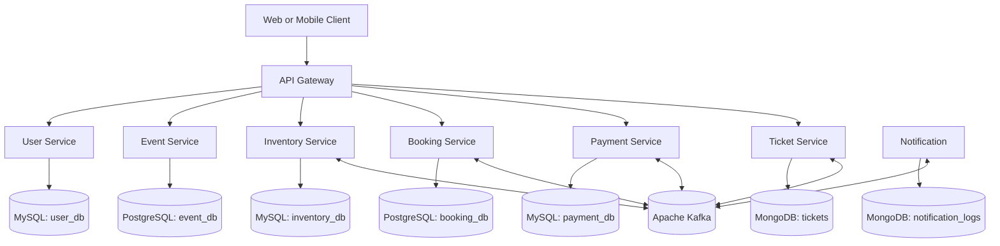
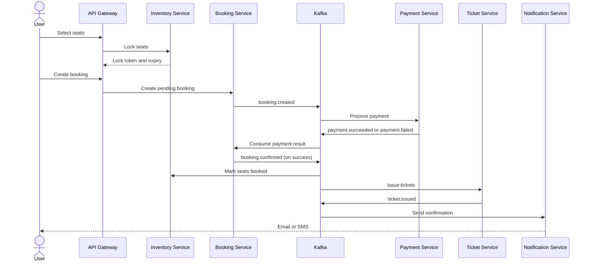

# Event Booking Microservices Platform

A real-world event ticket booking platform inspired by BookMyShow and Eventbrite, built with **Java, Spring Boot, Apache Kafka, MySQL, PostgreSQL, and MongoDB**.

Users can discover events, select seats, temporarily lock them, pay for bookings, and receive QR-code tickets. The project focuses on backend engineering topics such as microservices, event-driven communication, concurrency control, distributed transactions, idempotency, and observability.

## Table of Contents

- [Features](#features)
- [Architecture](#architecture)
- [Technology Stack](#technology-stack)
- [Microservices](#microservices)
- [Database Design](#database-design)
- [API Design](#api-design)
- [Kafka Events](#kafka-events)
- [Booking Workflow](#booking-workflow)
- [Reliability and Concurrency](#reliability-and-concurrency)
- [Project Structure](#project-structure)
- [Implementation Roadmap](#implementation-roadmap)
- [Testing Scenarios](#testing-scenarios)
- [Future Enhancements](#future-enhancements)

## Features

- User registration, authentication, and role-based authorization
- Event, venue, and show management
- Event search by city, category, and date
- Seat availability and temporary seat locking
- Booking lifecycle management
- Payment initiation, status tracking, and refunds
- QR-code ticket generation and check-in validation
- Email and SMS notifications
- Kafka-based asynchronous communication
- Idempotent payment requests and event consumers
- Expiring seat locks and unpaid-booking cleanup
- Retry handling, dead-letter topics, and reconciliation
- Docker-based local development and integration testing

## Architecture



> Each microservice owns its data. Services must not directly read or update another service's database tables. Use REST APIs or Kafka events for cross-service communication.

## Technology Stack

| Area | Technology |
|---|---|
| Language | Java |
| Framework | Spring Boot |
| API Gateway | Spring Cloud Gateway |
| Security | Spring Security, JWT |
| Service discovery | Eureka (optional) |
| Synchronous communication | REST APIs |
| Asynchronous communication | Apache Kafka, Spring Kafka |
| Relational database | MySQL |
| Relational database | PostgreSQL |
| Document database | MongoDB |
| Cache and temporary coordination | Redis (recommended) |
| Database migrations | Flyway |
| Testing | JUnit 5, Mockito, Testcontainers |
| Containers | Docker, Docker Compose |
| Monitoring | Spring Boot Actuator, Prometheus, Grafana |
| Tracing | OpenTelemetry (optional) |
| CI/CD | GitHub Actions |

## Microservices

| Service | Responsibilities | Database |
|---|---|---|
| API Gateway | Routing, JWT validation, rate limiting | None |
| User Service | Registration, login, profiles, roles | MySQL |
| Event Service | Events, venues, show schedules | PostgreSQL |
| Inventory Service | Seat inventory, locks, availability | MySQL; Redis optional |
| Booking Service | Pending bookings, confirmation, cancellation | PostgreSQL |
| Payment Service | Payment attempts, provider callbacks, refunds | MySQL |
| Ticket Service | Ticket issuance, QR tokens, check-in | MongoDB |
| Notification Service | Email/SMS delivery and notification history | MongoDB |

## Database Design

### 1. PostgreSQL — `event_db`

#### `venues`

| Column | Type | Notes |
|---|---|---|
| id | BIGINT | Primary key |
| name | VARCHAR(150) | Required |
| city | VARCHAR(100) | Required |
| address | TEXT | Venue address |
| capacity | INT | Must be greater than zero |

#### `events`

| Column | Type | Notes |
|---|---|---|
| id | BIGINT | Primary key |
| title | VARCHAR(200) | Required |
| description | TEXT | Event description |
| category | VARCHAR(50) | Concert, conference, sports, etc. |
| organizer_id | VARCHAR(36) | User Service ID; no cross-database FK |
| venue_id | BIGINT | FK to `venues.id` |
| status | VARCHAR(20) | Draft, published, cancelled |
| created_at | TIMESTAMPTZ | Creation time |

#### `shows`

| Column | Type | Notes |
|---|---|---|
| id | BIGINT | Primary key |
| event_id | BIGINT | FK to `events.id` |
| starts_at | TIMESTAMPTZ | Start time |
| ends_at | TIMESTAMPTZ | Must be after start time |
| status | VARCHAR(20) | Scheduled, cancelled |

Suggested indexes: `venues(city)` and `shows(event_id, starts_at)`.

### 2. PostgreSQL — `booking_db`

#### `bookings`

- `id UUID PRIMARY KEY`
- `booking_reference VARCHAR(40) UNIQUE NOT NULL`
- `user_id VARCHAR(36) NOT NULL`
- `show_id BIGINT NOT NULL`
- `status VARCHAR(30) NOT NULL`
- `total_amount NUMERIC(12,2) NOT NULL`
- `currency CHAR(3) NOT NULL DEFAULT 'INR'`
- `expires_at TIMESTAMPTZ`
- `created_at TIMESTAMPTZ NOT NULL`
- `updated_at TIMESTAMPTZ NOT NULL`

#### `booking_items`

- `id BIGINT PRIMARY KEY`
- `booking_id UUID NOT NULL` — FK to `bookings.id`
- `seat_id VARCHAR(80) NOT NULL` — Inventory Service identifier
- `unit_price NUMERIC(12,2) NOT NULL`
- Unique constraint on `(booking_id, seat_id)`

Suggested indexes: `(user_id, created_at DESC)` and `(status, expires_at)` on `bookings`.

### 3. MySQL — `user_db`

#### `users`

- `id CHAR(36) PRIMARY KEY`
- `full_name VARCHAR(120) NOT NULL`
- `email VARCHAR(255) UNIQUE NOT NULL`
- `password_hash VARCHAR(255) NOT NULL`
- `role ENUM('CUSTOMER', 'ORGANIZER', 'ADMIN')`
- `status ENUM('ACTIVE', 'BLOCKED')`
- `created_at TIMESTAMP`

Store only a secure password hash, such as BCrypt or Argon2. Never store plaintext passwords.

### 4. MySQL — `inventory_db`

#### `show_seats`

- `id BIGINT AUTO_INCREMENT PRIMARY KEY`
- `show_id BIGINT NOT NULL`
- `seat_number VARCHAR(20) NOT NULL`
- `category VARCHAR(30) NOT NULL`
- `price DECIMAL(12,2) NOT NULL`
- `status ENUM('AVAILABLE', 'LOCKED', 'BOOKED')`
- Unique constraint on `(show_id, seat_number)`

#### `seat_locks`

- `id BIGINT AUTO_INCREMENT PRIMARY KEY`
- `show_id BIGINT NOT NULL`
- `seat_number VARCHAR(20) NOT NULL`
- `booking_id CHAR(36) NOT NULL`
- `lock_token CHAR(36) UNIQUE NOT NULL`
- `expires_at DATETIME(3) NOT NULL`
- Unique constraint on `(show_id, seat_number)`
- Index on `expires_at`

Create and release a lock within a database transaction. Validate lock ownership and expiry before confirmation. A lock cleanup worker should release expired locks only when the seat has not been booked.

### 5. MySQL — `payment_db`

#### `payments`

- `id CHAR(36) PRIMARY KEY`
- `booking_id CHAR(36) NOT NULL`
- `idempotency_key VARCHAR(100) UNIQUE NOT NULL`
- `amount DECIMAL(12,2) NOT NULL`
- `currency CHAR(3) NOT NULL DEFAULT 'INR'`
- `status ENUM('PENDING', 'SUCCESS', 'FAILED', 'REFUNDED')`
- `provider_reference VARCHAR(150) UNIQUE`
- `created_at TIMESTAMP`

Payment status and booking status are separate state machines. The Payment Service publishes payment outcomes; the Booking Service owns booking status.

### 6. MongoDB — `tickets`

Example document:

```json
{
  "_id": "ticket-uuid",
  "bookingId": "booking-uuid",
  "userId": "user-uuid",
  "eventId": 101,
  "showId": 1001,
  "seatNumber": "A12",
  "ticketStatus": "ACTIVE",
  "qrToken": "random-signed-token",
  "issuedAt": "2026-10-29T10:30:00Z",
  "checkedInAt": null
}
```

Create a unique compound index on `{ bookingId: 1, seatNumber: 1 }` to prevent duplicate ticket documents on retries. QR tokens should be unpredictable and validated server-side.

### 7. MongoDB — `notification_logs`

Suggested fields:

- `bookingId`
- `userId`
- `channel` (`EMAIL` or `SMS`)
- `template`
- `deliveryStatus`
- `attemptCount`
- `lastAttemptAt`
- `providerMessageId`
- `createdAt`

## API Design

Base URL for local development: `http://localhost:8080/api/v1`

### User Service

| Method | Endpoint | Description |
|---|---|---|
| POST | `/auth/register` | Register a user |
| POST | `/auth/login` | Authenticate and issue JWT |
| GET | `/users/me` | Get current user's profile |
| PATCH | `/users/me` | Update profile |
| GET | `/users/{userId}` | Authorized user lookup |

### Event Service

| Method | Endpoint | Description |
|---|---|---|
| POST | `/events` | Create an event |
| GET | `/events` | Search/filter events |
| GET | `/events/{eventId}` | Get event details |
| PUT | `/events/{eventId}` | Update an event |
| POST | `/events/{eventId}/shows` | Create a show |
| GET | `/events/{eventId}/shows` | List shows |
| GET | `/shows/{showId}` | Get show details |

Example search:

`GET /api/v1/events?city=Chennai&category=CONCERT&date=2026-11-15&page=0&size=20`

### Inventory Service

| Method | Endpoint | Description |
|---|---|---|
| GET | `/shows/{showId}/seats` | Get seat map |
| POST | `/seat-locks` | Lock selected seats |
| GET | `/seat-locks/{lockToken}` | Get lock status |
| DELETE | `/seat-locks/{lockToken}` | Release an eligible lock |
| GET | `/shows/{showId}/availability` | Get availability |

Example `POST /seat-locks` request:

```json
{
  "showId": 1001,
  "seatNumbers": ["A12", "A13"]
}
```

Example response:

```json
{
  "lockToken": "lock-uuid",
  "status": "LOCKED",
  "expiresAt": "2026-10-29T11:05:00Z"
}
```

Use a short lock duration (for example, five minutes). Validate the authenticated user and lock ownership. A client must not be allowed to release another user's lock or a booked seat.

### Booking Service

| Method | Endpoint | Description |
|---|---|---|
| POST | `/bookings` | Create a pending booking |
| GET | `/bookings/{bookingId}` | Get booking details |
| GET | `/bookings/my` | Get current user's bookings |
| POST | `/bookings/{bookingId}/confirm` | Internal confirmation workflow |
| POST | `/bookings/{bookingId}/cancel` | Cancel an eligible booking |

Example `POST /bookings` request:

```json
{
  "showId": 1001,
  "seatNumbers": ["A12", "A13"],
  "lockToken": "lock-uuid"
}
```

Example response:

```json
{
  "bookingId": "booking-uuid",
  "status": "PENDING",
  "totalAmount": 1500.00,
  "currency": "INR",
  "expiresAt": "2026-10-29T11:05:00Z"
}
```

Calculate prices on the server using verified inventory prices; never trust client-supplied totals. Protect internal endpoints from public access.

### Payment Service

| Method | Endpoint | Description |
|---|---|---|
| POST | `/payments` | Initiate payment |
| GET | `/payments/{paymentId}` | Get payment status |
| POST | `/payments/{paymentId}/refund` | Initiate refund |
| POST | `/payments/webhooks/{provider}` | Receive payment provider callback |

Example request:

```json
{
  "bookingId": "booking-uuid",
  "paymentMethod": "UPI"
}
```

Send an `Idempotency-Key` header. Repeated requests with the same key must not create duplicate charges. Verify webhook signatures and provider payment status.

### Ticket Service

| Method | Endpoint | Description |
|---|---|---|
| GET | `/bookings/{bookingId}/tickets` | List tickets for a booking |
| GET | `/tickets/{ticketId}` | Get ticket details |
| GET | `/tickets/{ticketId}/qr` | Get QR code |
| POST | `/tickets/validate` | Validate a ticket at entry |

### Notification Service

| Method | Endpoint | Description |
|---|---|---|
| GET | `/notifications/my` | Get current user's notification history |
| GET | `/notifications/{id}` | Get notification details |

Notifications should normally be triggered by Kafka events rather than synchronous calls from the booking request.

## Kafka Events

Suggested topics:

| Topic | Producer | Consumer(s) |
|---|---|---|
| `booking.created` | Booking Service | Payment Service |
| `payment.succeeded` | Payment Service | Booking Service |
| `payment.failed` | Payment Service | Booking Service |
| `booking.confirmed` | Booking Service | Inventory, Ticket, Notification |
| `booking.cancelled` | Booking Service | Inventory, Notification |
| `refund.completed` | Payment Service | Booking, Notification |
| `ticket.issued` | Ticket Service | Notification |

Example event payload:

```json
{
  "eventId": "event-uuid",
  "eventType": "PaymentSucceeded",
  "bookingId": "booking-uuid",
  "paymentId": "payment-uuid",
  "amount": 1500.00,
  "currency": "INR",
  "occurredAt": "2026-10-29T10:35:00Z"
}
```

Use a stable event key such as `bookingId` where ordering per booking is required. Kafka ordering is guaranteed only within a partition; it does not by itself prevent double booking across different bookings.

## Booking Workflow



## Reliability and Concurrency

### Distributed transaction strategy

A single ACID transaction cannot span PostgreSQL, MySQL, MongoDB, and Kafka. Use a **Saga-style workflow with eventual consistency**, explicit state transitions, and compensating actions.

- **Transactional Outbox:** persist the business update and outgoing event in the same local database transaction; publish the outbox event asynchronously.
- **Idempotent consumers:** record processed event IDs or enforce unique business keys to tolerate redelivery.
- **Seat concurrency control:** use unique constraints and atomic conditional updates or row locks in the Inventory Service.
- **Payment idempotency:** use provider-supported idempotency where available and enforce a unique local idempotency key.
- **Retries and dead-letter topics:** retry transient errors with backoff; route exhausted failures to a dead-letter topic for investigation.
- **Lock expiry:** release expired locks safely without releasing booked seats.
- **Reconciliation:** compare provider payment status with local booking/payment state and repair recoverable inconsistencies.
- **Compensation:** if payment succeeds but booking cannot be confirmed, retry confirmation and initiate a refund when confirmation is no longer possible. Never assign an already-booked seat to another user.

Suggested booking states:

- `PENDING`
- `PENDING_PAYMENT`
- `CONFIRMED`
- `PAYMENT_FAILED`
- `CANCELLED`
- `REFUND_PENDING`
- `REFUNDED`

Keep payment states separate, such as `PENDING`, `SUCCESS`, `FAILED`, and `REFUNDED`. Define and validate legal state transitions rather than allowing arbitrary updates.

## Project Structure

```text
event-booking-platform/
├── api-gateway/
├── discovery-service/          # Optional if using Eureka
├── user-service/
├── event-service/
├── inventory-service/
├── booking-service/
├── payment-service/
├── ticket-service/
├── notification-service/
├── docker-compose.yml
└── README.md
```

Suggested package layout inside each Spring Boot service:

```text
com.example.booking
├── controller/
├── service/
├── repository/
├── entity/
├── dto/
│   ├── request/
│   └── response/
├── kafka/
│   ├── producer/
│   ├── consumer/
│   └── event/
├── config/
├── exception/
└── enums/
```

## Implementation Roadmap

- [ ] **Phase 1 — Infrastructure:** Docker Compose, Kafka, MySQL, PostgreSQL, MongoDB, Redis, and API Gateway.
- [ ] **Phase 2 — User and Event:** JWT authentication, roles, venue/event/show CRUD, and Flyway migrations.
- [ ] **Phase 3 — Inventory:** seat map, atomic locking, expiry cleanup, and concurrency tests.
- [ ] **Phase 4 — Booking:** pending booking, server-side price calculation, idempotency, and state transitions.
- [ ] **Phase 5 — Payment and Kafka:** payment sandbox, event producers/consumers, Saga workflow, and Transactional Outbox.
- [ ] **Phase 6 — Tickets and Notifications:** QR generation, MongoDB, email/SMS, and duplicate-event protection.
- [ ] **Phase 7 — Production readiness:** unit/integration tests, Testcontainers, Actuator, metrics, tracing, Docker, and load tests.

## Testing Scenarios

1. Two users try to book the same seat at the same time: only one succeeds.
2. The payment request is retried with the same idempotency key: no duplicate charge is created.
3. A `payment.succeeded` event is delivered twice: only one ticket per booking seat is issued.
4. Payment fails: eligible seat locks are released.
5. Kafka is unavailable after a database commit: the outbox event is eventually published.
6. Seat-lock expiry races with a payment callback: the system avoids confirming an invalid or already-booked seat.
7. A forged QR token is submitted: validation fails.
8. The same ticket is scanned twice: the second check-in is rejected.
9. An organizer tries to edit another organizer's event: authorization denies the request.
10. Load testing sends many concurrent requests for the same seat: inventory invariants remain intact.

## Future Enhancements

- Redis caching for event details and seat-availability snapshots
- Elasticsearch for event discovery
- API Gateway rate limiting
- Prometheus and Grafana dashboards
- OpenTelemetry distributed tracing
- GitHub Actions CI/CD
- Spring AI event assistant using tool calling to search events by city, category, and date

## Learning Goals

This project is designed to demonstrate practical knowledge of:

- Spring Boot and REST API design
- Microservice boundaries and database ownership
- Kafka producers, consumers, partitioning, retries, and dead-letter topics
- SQL schema design, indexes, and transaction boundaries
- Seat-lock concurrency and race-condition prevention
- Saga, Transactional Outbox, eventual consistency, and compensation
- Payment idempotency and webhook verification
- Automated testing, containerization, and observability
